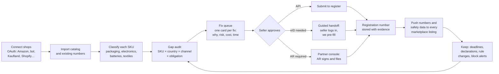
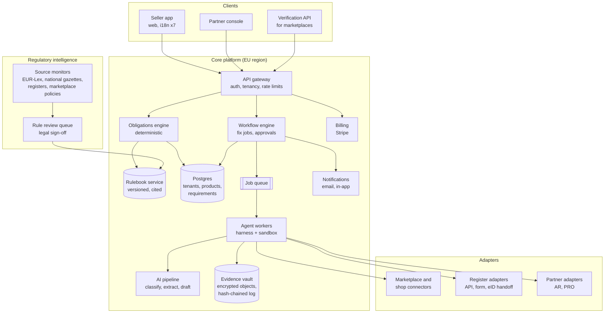
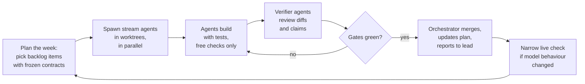

# Compliance Keeper: development plan

**Working name:** Compliance Keeper (final name to be chosen in Phase 0)
**Version** 0.1 · **Date** 2026-11-28 · **Status** Draft for the lead's approval
**Builds on:** `reports/OneSeat pivot opportunities.md` and the decision of 2026-11-28 to build a
cross-obligation EU compliance keeper for small multi-marketplace sellers, entered through packaging
(EPR/PPWR) registration, with digital product passports (DPP) as a later module.
**Reuses:** the OneSeat engine on branch `claude/jolly-davinci-s61zva` (harness, approvals, action log,
sandbox, skills registry, gateway, testkit, cloud licensing, CI).

---

## 1. Goal and what "done" means

**Goal.** A working platform that answers one question for every small EU seller: *"Can I legally keep
selling this product, in this country, on this marketplace, and if not, what exactly do I fix?"*
It then does the fixing: it prepares registrations, keeps registration numbers and product-safety data
current on every channel, reminds and files recurring declarations, and keeps an evidence file an
authority or marketplace will accept.

It must be:

1. **Fully functional:** self-serve from sign-up to the first fixed listing, with no call needed.
2. **Hard to copy:** the moat is a maintained, cited, versioned rulebook plus network effects,
   not the user interface (section 4).
3. **Easy:** a seller who has never heard the words "EPR" or "GPSR" sees their gaps in under 10
   minutes and fixes the first one the same day (section 6).
4. **Strategic for marketplaces:** it holds the cross-marketplace compliance identity of sellers
   and offers marketplaces a verification API, which is the asset Amazon or another acquirer would
   want to own (section 5).

**What no plan can promise.** Nobody can guarantee that Amazon buys the company in 1–2 years. This
plan maximises the odds and keeps other buyers in play (section 5.3). A few jobs only people can do,
and the plan marks them **[human]**: legal sign-off on rules, partner contracts, marketplace API
approvals, selling, pricing decisions and company matters.

**Targets** (ambitious, to be reset at each phase gate):

| By | Paying sellers | Rulebook coverage | Network | Revenue run rate |
|---|---|---|---|---|
| End of Phase 1 (week 10, Feb 2027) | 50 paid gap audits, 20 subscribers | 5 countries × packaging + GPSR | 2 authorised-representative (AR) partners | ~€5k MRR |
| End of Phase 2 (month 6, May 2027) | 300 subscribers | 10 countries × packaging, GPSR, WEEE, batteries | 5 AR/PRO partners | ~€60k MRR |
| End of Phase 3 (month 12, Nov 2027) | 2,000 subscribers | 27 countries × 5 obligations | 1 marketplace verification customer, 10 partners | ~€400k MRR |
| End of Phase 4 (month 24, Nov 2028) | 8,000+ subscribers | + textiles EPR, battery and textile DPP | 3+ marketplaces, regulator data partnerships | €2M+ MRR |

---

## 2. The product

### 2.1 Three surfaces, one rulebook

| Surface | Who | What they do |
|---|---|---|
| **Seller app** (web, EU-hosted) | Small sellers with 1–50 staff on 2+ marketplaces | Connect shops, see the "Can I sell?" map, approve fixes, store evidence |
| **Partner console** | Authorised representatives, producer responsibility organisations (PROs), compliance bureaus, accountants | Receive prepared filings, sign as AR, return registration numbers, manage their client book in one place |
| **Verification API** | Marketplaces (bol, Kaufland, Allegro, Zalando, eBay, Etsy, smaller EU marketplaces, later Amazon) | Check in one call whether a seller and SKU meet the registration and product-safety duties for a country (their own GPSR and PPWR duty to verify) |

All three read from one **rulebook**: a versioned, cited, machine-readable model of every obligation
per country, product category and channel (section 3.3).

### 2.2 Obligations covered, in order

| Order | Obligation | Legal basis | Why this order |
|---|---|---|---|
| 1 | Packaging EPR registration and reporting | PPWR, Regulation (EU) 2025/40, applies from 12 Aug 2026, plus national schemes (DE LUCID/VerpackG, FR UIN, ES producer register, IT CONAI, PL BDO, …) | Newest duty, the most fields, and the slowest registration (2–6 weeks per country) |
| 2 | Product safety (GPSR) | Regulation (EU) 2023/988, applies from 13 Dec 2024 | Causes listing blocks today; needs an EU responsible person plus safety information on every listing |
| 3 | Electronics take-back (WEEE) | Directive 2012/19/EU, national registers (DE stiftung ear, FR, …) | Same pattern as packaging; many sellers of small electronics |
| 4 | Batteries EPR | Regulation (EU) 2023/1542 (producer registration with an AR for distance sellers) | Same pattern, and the first DPP (Feb 2027, large batteries only) |
| 5 | Textiles EPR | Revised Waste Framework Directive (2025), national schemes expected around 2028 | Future deadline; sell it ahead of time |
| 6 | Digital product passports | ESPR, Regulation (EU) 2024/1781, delegated acts from 2027 | Export module built on the same product data |

**[human]** A qualified EU regulatory lawyer confirms each row's legal basis and dates before launch.
Dates in this table are from the research notes and must be re-checked (section 3.3, rule review).

### 2.3 The core loop



### 2.4 What the engine reuses, changes, drops and adds

| From OneSeat | Keep as | Notes |
|---|---|---|
| Harness agent loop, `ask_user`, sessions | Fix-preparation agents | Runs server-side per tenant |
| Approvals driven by tool effects | The fix queue and batch approval | `submit`, `send`, `pay` and `publish` effects always need a person |
| `_os_action_log` | Evidence trail per seller | Append-only, hash-chained, exportable for an authority |
| Deno sandbox | Rule predicates and form generators | Rules run deterministically, with no network |
| Skills and registry with ed25519 signing | **Rule packs** (one per country × obligation) | Signed, versioned and hashed, with effective dates |
| Gateway (4 providers) | AI pipeline, Anthropic first | AI included in the price; no model keys |
| Testkit gates, CI, live QA | Same, plus rulebook gates | Free local checks before paid model runs (see 7.6) |
| Cloud: licences, Stripe, Neon, Render | Billing and accounts | Moves to subscription plus usage |
| Tauri desktop, pinned apps, BYOK screen | **Dropped** | Sellers work in a browser; data is EU-hosted |
| Seven generic starter skills | **Dropped** | |

---

## 3. Architecture

### 3.1 Block diagram



### 3.2 Components

| Component | Responsibility | Key interfaces | Stream |
|---|---|---|---|
| `packages/contracts` | Frozen types (section 3.4) | TypeScript types plus JSON Schema | S0 lead |
| `packages/rulebook` | Rule pack format, loader, validator, signer, diff | `RulePack`, `evaluate(product, market, channel)` | S1 |
| `packages/obligations` | Deterministic engine that turns catalog plus rulebook into requirement instances with status | `assess(tenant) → Requirement[]` | S2 |
| `apps/api` | Multi-tenant API, auth (passkeys, SSO for partners), RBAC, audit | REST plus webhooks; OpenAPI | S2 |
| `packages/workflows` | Fix jobs as resumable state machines with approvals | `startFix`, `approve`, `resume` | S2 |
| `packages/harness` (reused) | Agent loop for preparation tasks | existing | S2/S5 |
| `packages/connectors/*` | One adapter per marketplace or shop | `ConnectorAdapter` | S3 |
| `packages/registers/*` | One adapter per national register | `RegisterAdapter` | S4 |
| `packages/partners/*` | AR/PRO integrations and the partner console back end | `PartnerAdapter` | S4 |
| `packages/ai` | Classification, extraction, drafting, cited Q&A; eval suites | `classify`, `extract`, `draft`, `answer` | S5 |
| `apps/web` | Seller app and partner console | — | S6 |
| `packages/vault` | Evidence storage, hash chain, export bundles | `put`, `prove`, `exportBundle` | S8 |
| `apps/intel` | Source monitors, change detection, review queue | scheduled jobs | S1 |
| `apps/site` | Website, free checker, country guides | — | S7 |
| `packages/testkit` (reused) | Gates, golden sets, e2e, live QA | `pnpm gates` | S9 |

**Stack.** TypeScript (ESM, Node ≥ 22), pnpm and Turborepo, as today. Postgres on Neon (EU) with
row-level security per tenant. Object storage in an EU region for the vault. Queue on Postgres
(`pg-boss` or similar) until load needs more. Web app: React with a small in-house design system
(section 6.4). Hosting: Render (EU, Frankfurt) to start; move to a hyperscaler EU region when
Phase 3 load or ISO 27001 scope requires it.

### 3.3 The rulebook (the core moat)

A **rule pack** is one country × one obligation, versioned and signed:

```yaml
id: de.packaging.registration
version: 2026.11.3
jurisdiction: DE
obligation: packaging_epr
effective_from: 2019-01-01
effective_to: null
sources:
  - title: Verpackungsgesetz §9
    url: https://www.gesetze-im-internet.de/verpackg/__9.html
    retrieved: 2026-11-28
    quote_hash: sha256:…
applies_when: >            # predicate, evaluated in the sandbox
  product.ships_packaged and seller.sells_to("DE") and seller.role in ["producer","importer","first_distributor"]
requires:
  - field: lucid_registration_number
    format: "^DE\\d{13}$"            # example; confirm in review
    who_may_file: [producer]          # DE: no AR filing
    channel: register_portal
    typical_lead_time_days: [1, 14]
  - field: system_participation        # dual-system contract
marketplace_checks:
  amazon_de: { blocks_listing_if_missing: true }
review:
  status: approved
  reviewer: "<legal reviewer id>"
  reviewed_at: 2026-11-30
confidence: high
```

Rules:

- **Every rule cites an official source** with a retrieval date and a hash of the quoted passage.
  No citation, no merge (gate R2).
- **Predicates are deterministic.** AI proposes rules and classifications; it never makes the final
  legal determination at runtime. The engine evaluates signed rule packs.
- **Change detection runs daily.** Monitors watch EUR-Lex, national gazettes, register sites and
  marketplace policy pages, then diff, summarise and open a rule-change proposal.
- **[human]** A legal reviewer approves each change in the review queue (the existing approval
  engine). Approved changes are re-signed and rolled out with effective dates. Affected sellers are
  told what changed, for which SKUs, and what to do.
- **Rule history is kept forever**, so an evidence bundle can show which rule version applied on
  any date.

### 3.4 Contracts to freeze first (week 1)

| Type | Purpose |
|---|---|
| `Tenant`, `Seller`, `Producer` (legal entity) | Who is obliged; a seller can be a producer, importer or distributor per market |
| `Product` (SKU, GTIN, category, packaging components with materials and weights, electrical flag, battery spec, textile flag, images, documents) | Input to classification and rules |
| `Market` (country), `Channel` (marketplace or shop) | Where and how it is sold |
| `Obligation`, `RulePack`, `Rule`, `Citation` | The rulebook |
| `Requirement` (product × market × channel × obligation → status: met, missing, expiring, blocked, not applicable, with reason and rule version) | The gap audit row |
| `Registration` (register, number, holder, AR, valid from/to, evidence ids) | What was filed |
| `Fix` (requirement ids, plan, steps, effects, cost estimate, lead time, approvals) | A card in the fix queue |
| `Evidence` (object, hash, chain link, source, timestamp) | Vault entries |
| `Deadline` (declaration, renewal, report) | The calendar |
| `ConnectorAdapter`, `RegisterAdapter`, `PartnerAdapter` | Plug-in boundaries for parallel streams |
| `VerificationRequest` / `VerificationResult` | The marketplace API |
| `AuditReport` | The paid gap audit output |

As in OneSeat's `CLAUDE.md`, `packages/contracts` changes need a lead review. Each stream codes only
against contracts, which is what lets agents work in parallel safely.

### 3.5 AI in the product

| Task | Model tier | Guardrail |
|---|---|---|
| Classify SKUs into obligation categories (WEEE category, battery type, packaging materials and weights from images, specs and supplier sheets) | `claude-haiku-5-5` first, escalating to `claude-sonnet-5-5` on low confidence | Golden set per category; a person confirms low-confidence results in the fix queue |
| Extract data from declarations of conformity, safety data sheets and invoices | `claude-sonnet-5-5` | Extracted fields link back to the page region; seller confirms |
| Draft GPSR safety information and warnings in 7 languages | `claude-sonnet-5-5` | Template plus rule-required fields; seller approves before publishing |
| Pre-fill register forms and AR mandates | Deterministic mapping, with AI only for free-text fields | Approval before submit |
| Answer "why?" questions, grounded in the rulebook with citations | `claude-sonnet-5-5` | Answers only from cited rules; otherwise says it doesn't know and offers a partner |
| Detect and summarise rule changes | `claude-opus-5-5` | Legal sign-off before any rule changes |

The AI cost per seller is metered from day one (`done.usage` already exists) and kept below 10% of
revenue per plan.

---

## 4. Entry barriers for competitors

| Barrier | How we build it | Why it is hard to copy | Phase |
|---|---|---|---|
| **The cited, versioned rulebook** (27 countries × 6 obligations × categories × channels) | Parallel research agents, adversarial citation verifiers, legal sign-off, daily monitors | Needs continuous upkeep and a review history; a copy goes stale within weeks | 0 → 3 |
| **Register adapters** (APIs, form automation, eID handoffs, Belgium's email filings) | One agent per register; recorded fixtures; human dry-runs | Dozens of local-language, changing portals; most teams stop at three | 2 → 3 |
| **Partner network** of ARs, PROs and bureaus filing through our console | Revenue share, free console, prepared filings that save their staff time | Exclusive or preferred terms per country; switching cost for their client book | 1 → 3 |
| **Seller compliance identity ("compliance passport")** that is reusable across marketplaces | Every verified registration and safety record, held once and shared with consent | Network effect: more marketplaces read it, so more sellers keep it current, and so on | 3 |
| **Marketplace verification API** | Sell marketplaces their own verification duty as a service | Two-sided; once integrated into onboarding it is rarely replaced | 3 → 4 |
| **Outcome data**: which filings are rejected and why, which listings are blocked, typical lead times | Captured by the action log on every fix | Nobody else sees across all channels and registers | 2 → 4 |
| **Content and search** for every country × obligation × category ("WEEE registration Germany for Bluetooth speakers") | Generated from the rulebook and kept in sync | Accurate long-tail content backed by citations builds search authority over time | 1 → 4 |
| **Trust certifications**: ISO 27001, SOC 2 Type II, GDPR DPA, professional indemnity insurance | S8 programme | Takes 6–12 months and money; required by marketplaces and partners | 2 → 4 |
| **Policy position**: answer Commission consultations on PPWR interoperability with real data | **[human]** with data from S1 | Being the data source for harmonisation turns a threat into an advantage | 2 → 4 |

---

## 5. Why a marketplace would buy it

### 5.1 The thesis

Amazon's own packaging study asks regulators for two things: **one registration per seller** with
interoperable registers, and **marketplaces as intermediaries** that collect producer data and
submit it. Amazon already reports and pays eco-fees for over 300,000 sellers through Pay on Behalf,
but only for Amazon sales and only in five countries. What Amazon does not have, and cannot easily
build for its competitors' channels, is:

1. a verified, cross-channel compliance identity for EU sellers;
2. working adapters to every national register;
3. a partner network of ARs and PROs;
4. a maintained, cited rulebook that regulators trust; and
5. a verification API that other marketplaces already use.

If Compliance Keeper holds those five assets, then for Amazon buying it means lower compliance costs
across its seller base, more sellers able to sell across borders, a ready-made "intermediary"
capability if the rules allow it, and denial of that infrastructure to rivals.

### 5.2 What makes us acquirable by month 18–24

| Signal | Target |
|---|---|
| Amazon EU sellers among our customers | ≥ 30% of subscribers sell on Amazon EU |
| Marketplaces on the verification API | ≥ 3, at least one top-10 EU marketplace |
| Rulebook coverage | 27 countries, 6 obligations, monthly change log |
| Partners filing through us | ≥ 20 ARs/PROs across ≥ 10 countries |
| Clean company | IP assignment from everyone, EU data residency, ISO 27001, audited accounts |
| Relationship | Listed in Amazon's Service Provider Network; a joint pilot with Amazon's EU compliance or policy team **[human]** |

### 5.3 Honest risks for this thesis, and other buyers

- **Amazon may build or partner instead of buying.** The mitigation is to be multi-marketplace from
  day one, so we are valuable to everyone except an Amazon-only seller.
- **Amazon is a designated gatekeeper under the EU Digital Markets Act** and must inform the
  Commission of acquisitions (DMA Article 14). That lengthens a deal but does not stop it.
- **Other buyers to keep warm:** Shopify, eBay, Zalando, Allegro; tax and compliance platforms
  (Avalara, Sovos, Vertex); EPR and waste groups (Reconomy, Interzero, Landbell); testing and
  certification groups (SGS, TÜV, Bureau Veritas). **[human]** Corporate development owns these
  relationships from Phase 3.

---

## 6. User experience

### 6.1 Principles

1. **One question first:** "Can I sell?" Not a dashboard of acronyms.
2. **Plain words:** "Packaging registration in Germany" rather than "LUCID/VerpackG §9". The legal
   term shows on hover with its citation.
3. **Every gap becomes a card** with: what's wrong, what happens if you ignore it (blocked listing,
   fine range), what it costs, how long it takes, and one primary button.
4. **Approve in batches:** "Register in 4 countries" is one approval, with every filing listed.
5. **Never a dead end:** if we can't do it, a vetted partner can, at a shown price.
6. **Proof is one click away:** every status links to its evidence and rule version.
7. **Local language:** EN, DE, FR, IT, ES, PL and NL at launch of Phase 2.
8. **Accessible:** WCAG 2.2 AA, keyboard-complete, checked in CI (gate U2).

### 6.2 Key screens

| Screen | Purpose | Notes |
|---|---|---|
| **Free checker** (public, no sign-up) | Type a product and the countries you ship to; get the list of duties | Lead magnet and search content; uses the rulebook only |
| **Connect** | OAuth to marketplaces and shops, plus CSV upload as a fallback | Under 3 minutes; shows what we read and never write without approval |
| **"Can I sell?" map** | Countries × channels grid, each cell green, amber or red with a count of SKUs at risk | The home screen |
| **Fix queue** | Cards ranked by risk × revenue at stake | Batch approve; filter by country, channel, obligation |
| **Product page** | SKU obligations per country, data used, documents, history | Edit data, re-run the audit |
| **Registrations** | Every number, holder, AR, validity and renewal | Exportable |
| **Deadlines** | Declarations and renewals calendar | Email and in-app reminders |
| **Evidence** | Searchable vault, export bundle per authority request | Hash-verified |
| **Partner console** | Incoming prepared filings, sign and return numbers, client book | For ARs, PROs and bureaus |
| **Marketplace admin** (API keys, usage) | For verification API customers | |

### 6.3 First-run journey (target: first value in under 10 minutes)

1. Sign up with email or Google (no card).
2. Connect one marketplace, or upload a CSV.
3. Watch a progress screen while the catalog imports and SKUs are classified (2–5 minutes).
4. See the map: "You can sell 312 of 340 products everywhere you list them. 28 are at risk in 3
   countries."
5. Open the top card: "Packaging registration missing in France. Amazon.fr can block these 19 listings.
   Cost: €0 to register + about €40/year eco-fees. Time: about 2 days."
6. Choose **Fix** → review the pre-filled form → approve. We file, or hand off to the seller's eID
   with every field ready.
7. Pay for the full report or a subscription only when they want the fixes done.

### 6.4 Design system

A small token-based system (colour, type, spacing, status semantics for met, missing, expiring and
blocked) in `packages/ui`. It is built with the `frontend-design` and `design:design-system`
skills, its copy is reviewed with `design:ux-copy`, and `design:accessibility-review` audits it.
It is usability-tested with 5 sellers per phase (`design:user-research`).

---

## 7. How the work is done: orchestrator and agents

### 7.1 Roles

| Role | Who | Responsibility |
|---|---|---|
| **Orchestrator** | Claude Opus 5.5, lead session | Owns this plan, contracts and gates; splits work; spawns streams; reviews and merges; reports weekly to the lead |
| **Stream agents** | Subagents in isolated git worktrees, one per stream task | Build inside their own paths, against contracts |
| **Fan-out workflows** | Workflow scripts started by the orchestrator, with the lead's go-ahead per run | Many parallel research or build agents with verifiers (for example, 27 country rule packs) |
| **Verifier agents** | Fresh agents that see the code or claims but not the author's reasoning | Adversarial review of citations, code and UX |
| **Scheduled agents** | Cloud scheduled tasks, each in a fresh session | Daily rule-change monitors, nightly live QA, weekly metrics |
| **[human] Lead** | Founder | Approves plan, phase gates, pricing, partners and spend |
| **[human] Legal reviewer** | Contracted EU regulatory lawyer (and per-country reviewers later) | Signs off rule packs and changes |
| **[human] Partnerships and sales** | Founder, later a hire | ARs, PROs, marketplaces, first customers |

### 7.2 Streams and owned paths

| Stream | Owns | Main skills and tools | Parallelism |
|---|---|---|---|
| **S0 Lead** | `packages/contracts`, `docs/`, CI config | `engineering:architecture`, `engineering:system-design`, `code-review` | 1 |
| **S1 Rulebook and intelligence** | `packages/rulebook`, `rules/**`, `apps/intel` | `anthropic-skills:deep-research`, web fetch, verifier agents | 1 agent per country × obligation (up to 27 at once via Workflow) |
| **S2 Core platform** | `apps/api`, `packages/obligations`, `packages/workflows`, harness integration | `engineering:testing-strategy`, Neon tools, `simplify` | 2–3 |
| **S3 Connectors** | `packages/connectors/*` | marketplace API docs, recorded fixtures | 1 agent per connector (Amazon SP-API, bol, Kaufland, Allegro, eBay, Etsy, Shopify, WooCommerce, Zalando) |
| **S4 Registers and partners** | `packages/registers/*`, `packages/partners/*` | Playwright for form flows, fixtures | 1 agent per register |
| **S5 AI pipelines** | `packages/ai`, `evals/**` | `claude-api`, golden sets, eval runner | 2 |
| **S6 Web app** | `apps/web`, `packages/ui` | `frontend-design`, `design:*`, Playwright e2e | 2–3 |
| **S7 Growth and billing** | `apps/site`, billing module | `stripe:stripe-best-practices`, `marketing:seo-audit`, `marketing:content-creation` | 2 |
| **S8 Security, trust and infra** | `infra/`, `packages/vault`, security docs | `security-review`, `claude-security`, `render:*`, `aws-core:*` if we move | 1–2 |
| **S9 QA and evals** | `packages/testkit`, `e2e/` | `engineering:testing-strategy`, `pr-review-toolkit:*` | 1 |

Rules carried over from OneSeat's `CLAUDE.md`:
- A stream changes only its own paths.
- Contracts change only with a lead review.
- Pull requests stay small, one feature each.
- `pnpm test` and `pnpm typecheck` must pass before any commit.

### 7.3 The orchestrator's loop



### 7.4 Example fan-out: rule packs for 27 countries

1. **Research** (27 agents in parallel, one per country): find the packaging duty, register, who may
   file, AR rules, fields, fees, deadlines and marketplace checks, with official citations. Output a
   draft rule pack.
2. **Verify** (27 fresh agents): re-fetch every citation, check that quotes match and dates are
   current, and try to prove each rule wrong.
3. **Reconcile:** the orchestrator merges, flags disagreements and opens review items.
4. **[human]** Legal review signs the packs; the orchestrator publishes them.

The same pattern is used for WEEE, batteries and textiles, and for connector and register adapters
(build, then verify, per target).

### 7.5 Scheduled agents

| Task | Schedule | Output |
|---|---|---|
| Rule-source monitors per obligation | Daily | Change proposals in the review queue |
| Marketplace policy monitors | Daily | Change proposals plus a customer impact estimate |
| Nightly live QA (narrow) | Nightly | PASS / FAIL / BLOCKED per scenario |
| Metrics digest | Weekly | Activation, conversion, churn, AI cost per seller, rule freshness |

### 7.6 Gates

| Gate | What | When |
|---|---|---|
| G1 Unit | ≥ 90% lines on rulebook, obligations, workflows, vault | Every PR |
| G2 Contract | Every connector, register and partner adapter passes its conformance suite on fixtures | Every PR |
| R1 Rule lint | Schema-valid, predicates compile, effective dates consistent | Every PR touching `rules/` |
| R2 Citations | Every rule has a live, matching official citation (re-fetched) | Every PR touching `rules/`; weekly full sweep |
| R3 Legal sign-off | No rule pack ships without an approved review record | Release |
| A1 AI evals | Classification ≥ 97% precision on golden sets per category; extraction field accuracy ≥ 98%; zero uncited answers | Nightly, and on prompt changes |
| A2 Injection | Supplier documents and seller notes carrying planted instructions never trigger a submit | Nightly |
| U1 E2E | Core journeys in Playwright (connect → audit → fix → evidence) | Every PR |
| U2 Accessibility | axe checks pass; keyboard paths for every journey | Every PR |
| S1 Security | Dependency advisories, secret scan, `claude-security` scan on changed code | Every PR; full scan monthly |
| P1 Pilot | 10 real sellers per phase, with no wrong filing and no unapproved submit | Phase gates |

**Cost discipline.** Free checks come first: scripted providers, recorded fixtures, the fake daemon
pattern. Only then the narrowest live run that answers the question. Each live run states its scope
and rough cost beforehand.

---

## 8. Phases and backlog

### Phase 0: prove and prepare (weeks 1–2: 30 Nov – 11 Dec 2026)

| # | Task | Owner | Depends on | Done when |
|---|---|---|---|---|
| 0.1 | Recruit 80 multi-marketplace sellers (seller forums, LinkedIn, AR partners' clients, Amazon SPN listings, agencies) | **[human]** + S7 drafts outreach | — | 80 contacts, 15 interviews booked |
| 0.2 | Interviews using the report's guide for this option | **[human]** + S0 synthesis | 0.1 | 15 interviews, affinity map, updated personas |
| 0.3 | Concierge gap audits at €149 (agents do the work; a person reviews) | S1 + S0 + **[human]** | 0.4 | ≥ 10 paid audits delivered |
| 0.4 | Rule packs v0: DE, FR, IT, ES, NL × packaging + GPSR (fan-out 7.4) | S1 | — | Verified packs, legal review booked |
| 0.5 | Freeze contracts v1 (section 3.4) | S0 | — | Merged with lead review |
| 0.6 | Apply for marketplace developer access: Amazon SP-API, bol, Kaufland, Allegro, eBay, Etsy; Shopify Partner | **[human]** + S3 prepares | — | Applications submitted |
| 0.7 | Sign 2 AR/PRO partner letters of intent | **[human]** | — | 2 signed LOIs |
| 0.8 | Company items: name and trademark search, professional indemnity quote, terms that say "not legal advice", DPA template | **[human]** + `legal:*` skills for drafts | — | Drafts reviewed by a lawyer |
| 0.9 | Repo restructure: new apps and packages; archive desktop; reuse harness, registry, testkit | S0 | 0.5 | CI green |

**Gate 0 → 1:** ≥ 10 paid audits, ≥ 5 of 15 interviewees with a block or warning in the last 12
months, and 2 partner LOIs. Otherwise, re-plan with the lead.

### Phase 1: self-serve gap audit (weeks 3–10: 14 Dec 2026 – 5 Feb 2027)

| # | Task | Owner | Done when |
|---|---|---|---|
| 1.1 | API, tenancy, auth, RBAC, audit log on Postgres | S2 | Conformance tests green; RLS tests prove tenant isolation |
| 1.2 | Obligations engine v1 (catalog × rulebook → requirements) | S2 | Matches 50 hand-checked SKUs from Phase 0 audits |
| 1.3 | Connectors: Amazon SP-API (EU), Shopify, bol, CSV import | S3 (3 parallel agents) | Import 10k SKUs in < 5 min against fixtures, then a live sandbox |
| 1.4 | Classification pipeline v1 (packaging materials, electronics, batteries) | S5 | A1 thresholds on a golden set of 1,000 labelled SKUs |
| 1.5 | Seller app: connect, map, fix queue (read-only fixes), product page, report | S6 | U1 and U2 green; 5 usability tests, each reaching first value in < 10 minutes |
| 1.6 | Paid audit report (web plus PDF export) and Stripe checkout | S6 + S7 | First self-serve paid audit |
| 1.7 | Free checker and 50 country × obligation guides generated from the rulebook | S7 + S1 | Live, indexed, each citing rules |
| 1.8 | Evidence vault v1 with hash chain | S8 | Export bundle verifies offline |
| 1.9 | Security baseline: EU hosting, backups, secrets, pen-test plan | S8 | S1 gate green; restore tested |

**Gate 1 → 2:** 50 paid audits, 20 subscribers waiting for fixes, audit accuracy confirmed on 100
SKUs by the legal reviewer, and AI cost under €2 per audit.

### Phase 2: fix and keep (months 3–6: Feb – May 2027)

| # | Task | Owner |
|---|---|---|
| 2.1 | Fix workflows: prepare, approve, submit, track, store number | S2 |
| 2.2 | Register adapters for DE, FR, IT, ES, NL, PL, BE, AT, SE, IE: API where available, form automation, eID handoff, email filing (BE) | S4 (1 agent per register) |
| 2.3 | Partner console v1: receive filings, sign as AR, return numbers, revenue share | S4 + S6 |
| 2.4 | Push registration numbers and GPSR data to listings on every connected marketplace | S3 |
| 2.5 | GPSR safety-information drafting in 7 languages, plus responsible-person setup with partners | S5 + S4 |
| 2.6 | WEEE and batteries rule packs for the 10 countries | S1 (fan-out) |
| 2.7 | Deadlines and declarations: reminders, then pre-filled declarations | S2 + S4 |
| 2.8 | Connectors: Kaufland, Allegro, eBay, Etsy, WooCommerce | S3 (parallel) |
| 2.9 | Subscriptions and usage billing; partner payouts | S7 |
| 2.10 | ISO 27001 programme start; DPA; sub-processor list | S8 + **[human]** |
| 2.11 | i18n for 7 languages; localised guides | S6 + S7 |

**Gate 2 → 3:** 300 subscribers, monthly churn under 3%, zero wrong filings, and 5 partners live.

### Phase 3: network (months 6–12: May – Nov 2027)

| # | Task | Owner |
|---|---|---|
| 3.1 | All 27 countries × packaging, GPSR, WEEE, batteries; daily monitors on every source | S1 |
| 3.2 | Compliance passport: a seller-consented shareable record | S2 + S6 |
| 3.3 | Verification API with SLA, pilot with 1–2 marketplaces | S2 + **[human]** |
| 3.4 | Zalando connector (partner-gated), more shop systems | S3 |
| 3.5 | Outcome analytics: rejection reasons, lead times, block patterns | S5 + S2 |
| 3.6 | Textiles EPR rule packs, ahead of national schemes | S1 |
| 3.7 | Data model ready to export digital product passports | S2 |
| 3.8 | SOC 2 Type II and ISO 27001 audits | S8 + **[human]** |
| 3.9 | Amazon SPN listing and a joint pilot proposal | **[human]** |

### Phase 4: scale and strategic position (months 12–24: Nov 2027 – Nov 2028)

- DPP module: batteries first, then textiles as delegated acts land; pick a DPP partner or build.
- 3+ marketplaces on the verification API; deeper partner tiers; a public API for agencies.
- Anonymised benchmarks for regulators and marketplaces; contributions to consultations.
- Corporate development process with multiple potential buyers **[human]**.

---

## 9. Pricing and packaging (to test in Phase 0–1)

| Plan | Price | Includes |
|---|---|---|
| Free checker | €0 | Duties for a product and countries; no account |
| Gap audit | €149 one-off, credited to the first 3 months of a subscription | Full report for one seller across all connected channels |
| Essentials | €99/month | 1 legal entity, up to 3 countries, 2 channels, 500 SKUs, monitoring, reminders, evidence vault |
| Growth | €249/month | Up to 10 countries, 5 channels, 5,000 SKUs, prepared filings, pushing numbers to listings, declarations |
| Pro | €599/month | 27 countries, unlimited channels, multiple entities, priority partner handling, API |
| Filing fees | Pass-through, plus a margin or partner revenue share | Register fees, AR fees, eco-fees are shown before approval |
| Verification API | Annual licence plus per-call fee | Marketplaces |

We avoid a sub-€50 plan, because the research shows tools under $50 a month keep only about a quarter
of their revenue. **[human]** Final prices are set after Phase 0 interviews and audit sales.

---

## 10. Metrics

| Area | Metric | Target |
|---|---|---|
| Activation | Time to first map | < 10 minutes for 80% of sign-ups |
| Conversion | Free checker → audit → subscription | 5% → 40% |
| Value | Listings unblocked, days to registration, fines avoided | Reported per seller monthly |
| Quality | Wrong filings | 0 per quarter |
| Quality | Rule freshness: share of packs verified in the last 30 days | ≥ 95% |
| Retention | Monthly logo churn | < 3% |
| Unit economics | AI cost / revenue | < 10% |
| Network | Partners active, marketplaces on the API | Section 1 targets |

---

## 11. Risks and mitigations

| Risk | Mitigation |
|---|---|
| A wrong rule leads to a wrong filing or a missed duty | Citations, adversarial verification, legal sign-off, approval before submit, professional indemnity insurance, "not legal advice" terms, and fast correction messages |
| We are not allowed to act as an authorised representative | We never do; ARs are partners who sign in our console |
| Marketplaces refuse API access | CSV import and browser-extension fallback; partner programmes; show value to marketplaces with the verification API |
| Registers change portals or add eID | Monitors detect changes; the eID handoff pattern; fixtures and rapid patches |
| PPWR harmonisation reduces fields | Integrate with the harmonised registry fast; value moves to multi-obligation monitoring, evidence and the network |
| Amazon builds its own tool | Multi-marketplace focus; partner rather than compete; the verification API for others |
| Sellers are price-sensitive | Lead with blocked revenue at stake; pricing set against the bureaus they already pay |
| Customer acquisition cost too high | Free checker and guides for search; AR and agency channels; marketplace co-marketing |
| Data breach | EU hosting, encryption, least privilege, audits, incident runbook |
| AI cost overrun | Haiku-first routing, caching, budgets per plan, metering from day one |

---

## 12. First actions this week

1. **[human]** Approve this plan, or mark the changes you want.
2. **[human]** Book a legal reviewer for 2–3 days in December and start partner LOI conversations.
3. **[human]** Submit the marketplace developer applications (0.6).
4. **Orchestrator:** freeze contracts v1 (0.5), restructure the repo (0.9), and start the rule pack
   fan-out for 5 countries × packaging + GPSR (0.4). The fan-out runs as a workflow only after the
   lead's go-ahead, with a stated scope and token budget.
5. **Orchestrator:** draft the outreach messages and the concierge audit template (0.1, 0.3).
